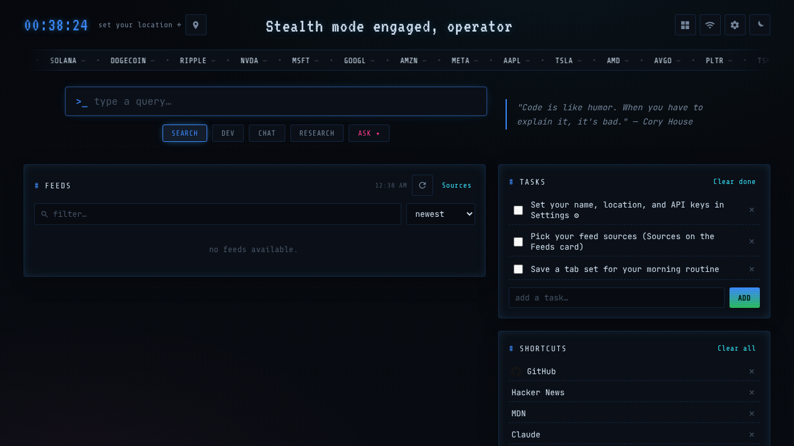

<div align="center">

# Crowsnest

**A hacker-flavored new tab page for Chrome.**
News feeds, market ticker, weather, tasks, notes, uptime monitors, tab sets, museum art, and an optional Claude assistant, all in one CRT-styled dashboard.


<!-- Screenshot taken offline; swap in one with live feeds when you can. -->


</div>

## Features

- **Feeds**: Lobsters, Lemmy, DEV, GNews, Hacker News, Reddit, Product Hunt, built-in RSS (TechCrunch, The Verge, Ars Technica, and more), plus your own RSS URLs. Toggle and size each source.
- **Article reader**: open a story in a modal with an optional AI summary from Claude.
- **Market ticker**: crypto (CoinGecko) and stocks (Stooq) with an editable watchlist and per-symbol detail.
- **Weather**: Open-Meteo forecast for your browser location, or any ZIP code or city you set. No API key.
- **Tasks, shortcuts, and notes**: a to-do list, quick links with favicons, and a rich-text notepad (Quill).
- **Monitors**: simple uptime checks for URLs you care about.
- **Tab sets**: save a group of tabs and reopen them in one click.
- **Art**: a random piece from the Cleveland Museum of Art, Art Institute of Chicago, or The Met.
- **Search bar with modes**: web, GitHub, Perplexity, or ask Claude directly.
- **Right-click search**: select text on any page and send it to Google, Wikipedia, MDN, Stack Overflow, YouTube, and more.
- **Google Maps acreage**: the Maps measure tool shows total acres next to square feet.
- **Themes**: dark and light, two accent colors, and a CRT scanline overlay.
- **Backup**: export and import all settings and data as JSON.

## Install

Crowsnest is not on the Chrome Web Store yet. Load it unpacked:

1. Download the latest release zip (or `git clone https://github.com/jrwray/crowsnest.git`).
2. Open `chrome://extensions` and turn on **Developer mode**.
3. Click **Load unpacked** and choose the `crowsnest` folder.
4. Open a new tab.

Works in Chrome, Edge, Brave, and other Chromium browsers.

## Configuration

Everything is set from the UI. Click the gear icon for **Settings**.

| Setting | Needed for | Where to get it |
| --- | --- | --- |
| Your name | The greeting in the top bar | Optional; defaults to "operator" |
| Anthropic API key | Ask Claude, article and market summaries | [console.anthropic.com](https://console.anthropic.com/) |
| Claude model | Optional, defaults to a Haiku model | Any model ID your key can use |
| GNews API key | The GNews feed | [gnews.io](https://gnews.io/) (free tier) |

Every other source works without a key.

### Privacy

Crowsnest has no server and no analytics. Keys and data live in `chrome.storage` in your browser. Claude requests go straight from your browser to `api.anthropic.com` using your own key. Feeds, weather, and art come from their public APIs (built-in RSS feeds are fetched through rss2json.com, and fonts load from Google Fonts); see `host_permissions` in [`manifest.json`](manifest.json) for the full list.

## Project layout

```
manifest.json     Extension manifest (MV3)
index.html        The new tab page
styles.css        Theme, layout, CRT overlay
src/              Dashboard logic as ES modules, one per feature
  main.js           Entry point: first-run setup and start-up order
  feeds.js          News sources (HN, Lobsters, Reddit, Lemmy, RSS, ...)
  news.js           Feed cards, article modal, source settings
  markets.js        Watchlist, ticker tape, quote details
  stooq.js          Stock quote parsing (pure, unit-tested)
  monitors.js       Uptime checks
  weather.js, clock.js, notes.js, tasks.js, shortcuts.js, art.js, ...
background.js     Service worker: right-click "search selection" menu
maps-content.js   Content script: acreage on Google Maps measurements
vendor/quill/     Vendored Quill 1.3.7 rich-text editor (BSD-3-Clause)
test/             Unit tests (Node's built-in test runner)
```

No build step and no dependencies to install. Edit a file, then click the reload icon on `chrome://extensions`. To run the checks CI runs, use `npm test` and `npm run lint` (Node 20+).

## Contributing

Issues and pull requests are welcome. See [CONTRIBUTING.md](CONTRIBUTING.md).

## License

[MIT](LICENSE). Quill is © Jason Chen and Slab, BSD-3-Clause.
